<picture>
  <source media="(max-width: 600px)" srcset="assets/banner-mobile.svg">
  
</picture>

  
  
  

**[Enter the Intelligence Lab](https://thameemhub.github.io/thameemhub/)** · [Research](#research--innovation) · [Projects](#intelligence-lab) · [Experience](#professional-experience) · [Telemetry](#developer-telemetry) · [Contact](#contact)

## Technical identity

I’m **Mohammed Thameem Sulthan M.**, an AI and data science engineer in Chennai, India. Two questions keep turning up in my work. What can a detector learn from five labeled examples? When a chatbot answers a question about a document, can I trace its answer back to a page? My bottle-inspection notebooks and financial-report assistant let me test those questions in code.

**Education** · B.Tech in Artificial Intelligence and Data Science, St. Joseph’s College of Engineering, Chennai.

Developer configuration

~~~yaml
location: Chennai, India
systems: [conversational AI, retrieval-augmented generation, computer vision]
methods: [machine learning, deep learning, few-shot learning]
exploring: [agentic AI, retrieval evaluation, experimental model architectures]
collaborations: [applied AI research, generative AI, software development]
~~~

## Research & Innovation

I use small, testable comparisons to study applied AI. In few-shot vision, I’m interested in which mistakes a detector keeps making as the support set grows. In retrieval, I want to know whether the passage a model cites actually supports the claim it makes.

Explore the research questions and experiments

- **Few-shot detection.** When a detector adapts to a novel defect, how much does its performance on familiar defects change? The bottle experiments track base and novel classes separately. [Experiment notebook](https://github.com/thameemhub/Plastic_Bottle_Defect_Detection_By-FewShot-Object_Detection/blob/main/Extreme_RCNN.ipynb)
- **Visual generalization.** How much does recognition depend on handwriting samples sharing the same source? The Tamil evaluation compares ordinary and cross-source episodes. [Model comparison](https://github.com/thameemhub/Tamil_HandWritten_Character_Recognition/blob/main/reports/model_comparison.md)
- **Evidence in conversation.** Can a follow-up question retrieve the right page after the subject is omitted? My financial-report assistant has separate stages for rewriting a question, retrieving context, and checking confidence. [Pipeline](https://github.com/thameemhub/FINANCE_RAG_CHATBOT/blob/main/src/pipeline.py)

## Technical ecosystem

  
  
  
  
  
  

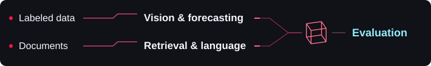

## Intelligence Lab

Select a card to open its repository, or expand an experiment below to see the method and evidence.

  <a href="https://github.com/thameemhub/Plastic_Bottle_Defect_Detection_By-FewShot-Object_Detection">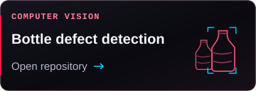</a>
  
  <a href="https://github.com/thameemhub/Tamil_HandWritten_Character_Recognition">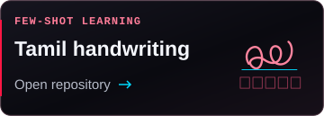</a>
  <a href="https://github.com/thameemhub/FACE-VERIFICATION-SYSTEM---COMPUTER-VISION">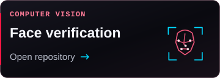</a>
  <a href="https://github.com/thameemhub/Violet_App">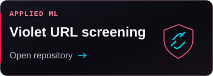</a>
  <a href="https://github.com/thameemhub/WEATHER_PREDICTION_LSTM">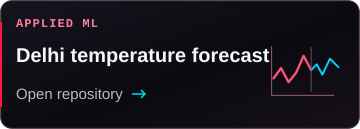</a>

<strong>Bottle defect detection</strong> · Learning rare defects from a few labels.

A production line can have plenty of bottle images and very few examples of a missing cap or a crumpled bottle. These notebooks explore how a detector adapts when only a handful of novel-class boxes are labeled.

The Extreme R-CNN notebook trains on base classes first, then adapts its detector with few-shot support. Separate heads learn class embeddings and box coordinates. Evaluation tracks AP50 for both base and novel defects to expose forgetting.

**Bottle images** → **Base detector** → **Few-shot adaptation** → **Defect boxes**

[Inspect the experiment](https://github.com/thameemhub/Plastic_Bottle_Defect_Detection_By-FewShot-Object_Detection/blob/main/Extreme_RCNN.ipynb)

*Python · PyTorch · Detectron2 · OpenCV*

<strong>Financial report RAG</strong> · Trace an answer back to the PDF page.

Finding a figure in a quarterly report is only half the job. A reader also needs the page it came from. This assistant retrieves report passages and attaches their file and page references to its answer.

PyMuPDF extracts pages, the ingestion pipeline chunks and embeds them, and ChromaDB retrieves candidates. A confidence gate checks the evidence before a Groq-hosted model generates a response. Follow-up questions are rewritten using session context.

**Report pages** → **ChromaDB** → **Evidence gate** → **Cited answer**

[Trace the pipeline](https://github.com/thameemhub/FINANCE_RAG_CHATBOT/blob/main/src/pipeline.py)

*Python · PyMuPDF · ChromaDB · Groq · Streamlit*

A companion airline assistant uses TF-IDF retrieval over custom policy documents and FLAN-T5 for answer generation. [AL Airways Smart Assistant](https://github.com/thameemhub/AL-RAG-CHATBOT---AL-AIRWAYS-SYSTEM-)

<strong>Tamil handwriting</strong> · Recognizing letters from support examples.

Tamil characters can differ by a small loop, stroke, or modifier. This project studies how many labeled examples a recognizer needs for a letter it has never seen during training.

The project compares episodic learners and supervised baselines, then separates known-letter performance from generalization to held-out letters. Its report also tests how recognition changes when support and query images come from different sources.

**Letter crops** → **Conv4 encoder** → **Class prototypes** → **Nearest class**

The repository reports 92.89% ± 3.37% accuracy on 5-way, 5-shot episodes drawn from 16 held-out letters. [Read the evaluation](https://github.com/thameemhub/Tamil_HandWritten_Character_Recognition/blob/main/reports/model_comparison.md)

*Python · PyTorch · Torchvision · OpenCV*

<strong>Face verification</strong> · Comparing a live capture with an ID portrait.

An interview identity check needs to compare two faces captured under different conditions. This Streamlit prototype guides a participant through a head-pose prompt and compares their image with a portrait on an identity document.

OpenCV prepares the images. InsightFace detects the faces and produces embeddings. The app compares those vectors with cosine similarity and displays the outcome alongside the pose check.

**ID + capture** → **Face detection** → **Embeddings** → **Similarity**

[Inspect the verification code](https://github.com/thameemhub/FACE-VERIFICATION-SYSTEM---COMPUTER-VISION/blob/main/face_verification.py)

*Python · InsightFace · OpenCV · NumPy · Streamlit*

<strong>Violet URL screening</strong> · Combining URL features with network context.

A suspicious link gives a reviewer little context on its own. Violet combines URL features with IP intelligence to surface phishing risk across an Android client and a web dashboard.

The project pairs an XGBoost classifier with lookup signals such as network ownership and reputation. A FastAPI service returns the assessment to its clients.

**URL** → **Feature extraction** → **Risk scoring** → **Review**

[Read the system design](https://github.com/thameemhub/Violet_App/blob/main/README.md)

*Python · XGBoost · FastAPI · Kotlin · React*

<strong>Delhi temperature forecast</strong> · Following a forecast beyond the next hour.

A single next-hour estimate hides how forecasting errors accumulate. This notebook studies hourly Delhi weather and rolls its one-step temperature predictions forward for a 24-hour view.

The notebook cleans and scales six weather variables, builds 60-step input windows, and trains a stacked LSTM. Each recursive step updates temperature while carrying the last observed non-temperature inputs forward.

**Weather records** → **60-step windows** → **Stacked LSTM** → **Forecast**

[Open the forecasting notebook](https://github.com/thameemhub/WEATHER_PREDICTION_LSTM/blob/main/weather-lstm.ipynb)

*Python · TensorFlow/Keras · pandas · scikit-learn*

## Professional experience

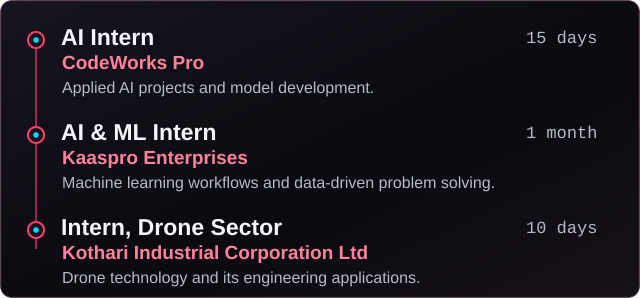

## Leadership & Community

As a **Google Student Ambassador**, I focus on AI awareness and knowledge sharing among students, including how AI-powered learning tools fit into everyday coursework.

As an **HCLTech Campus Ambassador**, I focus on campus participation, technology awareness, and professional development. The financial-report RAG assistant grew out of an ambassador assignment. [Project repository](https://github.com/thameemhub/FINANCE_RAG_CHATBOT)

## Achievements

  
  

Innovation and community milestones

- Patent holder.
- Google Student Ambassador and HCLTech Campus Ambassador.
- Multiple hackathon wins and technical competition wins.
- Three internships spanning applied AI, machine learning, and drone engineering.

## Developer Telemetry

<picture>
  <source media="(prefers-color-scheme: dark)" srcset="assets/generated/city-dark.svg">
  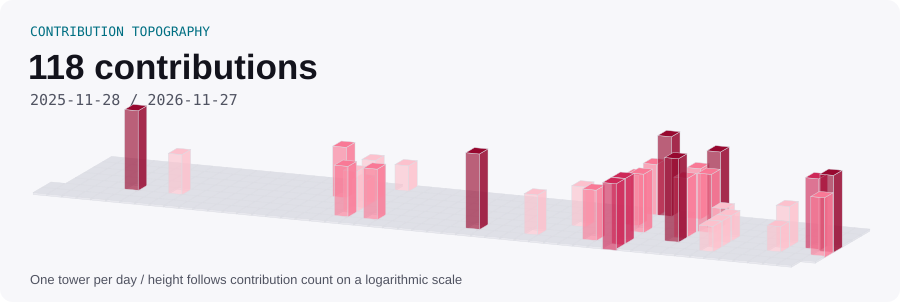
</picture>

<picture>
  <source media="(prefers-color-scheme: dark)" srcset="assets/generated/snake-dark.svg">
  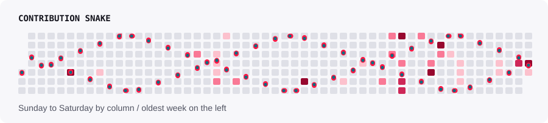
</picture>

<picture>
  <source media="(prefers-color-scheme: dark)" srcset="assets/generated/statistics-dark.svg">
  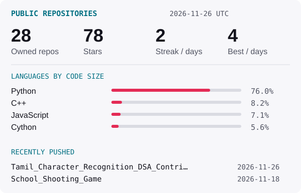
</picture>

The calendar covers the latest 365 UTC dates. Streaks count consecutive contributing days in that window, with today still open. Language shares use GitHub’s byte counts across my public, non-fork repositories. [Daily refresh workflow](https://github.com/thameemhub/thameemhub/actions/workflows/telemetry.yml)

## Current research and learning

- **Retrieval evaluation.** Testing how question rewriting and confidence thresholds affect follow-up answers.
- **Few-shot vision.** Comparing support-set size and sample source to understand where a model generalizes.
- **Agentic AI.** Exploring when a conversational system should call a tool, ask for more context, or return the evidence it already has.

## Contact

I’m based in **Chennai, India**, and open to **AI/ML internships, research collaborations, and generative AI projects**. I also welcome freelance development, technical collaborations, and innovation opportunities.

[thameem.s.ads@gmail.com](mailto:thameem.s.ads@gmail.com) · [LinkedIn](https://www.linkedin.com/in/mohammed-thameem-sulthan-m-01648a328/) · [GitHub](https://github.com/thameemhub)

